# Course Roadmap & Milestones

Visual timeline and milestone dependencies for the DevOps Engineering Bootcamp.

```mermaid
flowchart LR
    M1["01: Linux Fundamentals<br/>(In Progress)"] --> M2["02: Git & Version Control<br/>(Pending)"]
    M2 --> M3["03: Networking<br/>(Pending)"]
    M3 --> M4["04: Automation<br/>(Pending)"]
    M4 --> M5["05: Docker<br/>(Pending)"]
    M5 --> M6["06: CI/CD<br/>(Pending)"]
    M6 --> M7["07: AWS Cloud<br/>(Pending)"]
    M7 --> M8["08: Terraform IaC<br/>(Pending)"]
    M8 --> M9["09: Kubernetes<br/>(Pending)"]
    M9 --> M10["10: Observability<br/>(Pending)"]
    M10 --> M11["11: Security & DevSecOps<br/>(Pending)"]
    M11 --> M12["12: Capstone Projects<br/>(Pending)"]
```

## Milestone Tracking

- [ ] **Milestone 1: Linux Systems Mastery** (Target: Module 01 Complete)
- [ ] **Milestone 2: Networking & Version Control** (Target: Modules 02-03 Complete)
- [ ] **Milestone 3: Automation & Containers** (Target: Modules 04-05 Complete)
- [ ] **Milestone 4: Continuous Delivery & Cloud** (Target: Modules 06-07 Complete)
- [ ] **Milestone 5: IaC & Kubernetes Orchestration** (Target: Modules 08-09 Complete)
- [ ] **Milestone 6: SRE Observability & Security** (Target: Modules 10-11 Complete)
- [ ] **Milestone 7: Capstone Deployment Defense** (Target: Module 12 Complete)
